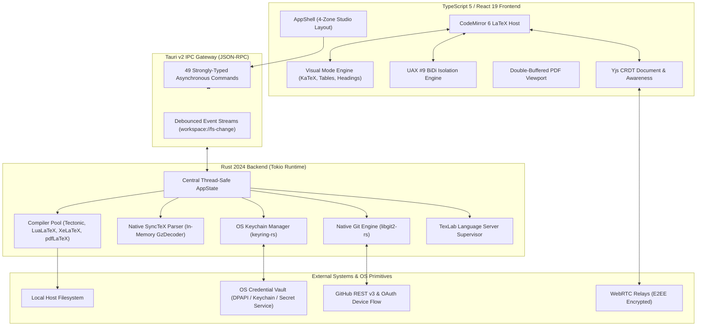

# LeafForge 🍃
### Local-First Collaborative LaTeX Desktop Studio

[](https://github.com/Abdo30004/LeafForge/actions/workflows/ci.yml)
[](https://github.com/Abdo30004/LeafForge/actions/workflows/release.yml)
[](https://github.com/Abdo30004/LeafForge/releases)
[](LICENSE)
[](https://tauri.app)
[](https://www.rust-lang.org)
[](https://react.dev)
[](https://www.typescriptlang.org)

**LeafForge** is a high-performance, local-first desktop alternative to cloud-locked LaTeX platforms like Overleaf. Engineered with **Tauri v2 (Rust)**, **React 19**, **CodeMirror 6**, and **Yjs CRDTs**, LeafForge bridges the lightning responsiveness and tactile elegance of **Zed** and **Linear** with offline-first document privacy, live peer-to-peer co-authoring, and native Git version control.

---

## 4-Zone Academic Studio Workspace

```text
+-----------------------------------------------------------------------------------+
| [Logo] NaturePaper / main.tex [v]  | [Raw | Visual] [Format] | [Avatars] [Compile] | <- 40px TopBar
+----+------------------+-----------------------------------+-----------------------+
|    | EXPLORER         | 1  \documentclass{article}        |  +-----------------+  |
| 📁 | > sections/      | 2  \usepackage{amsmath}           |  |                 |  |
| 📑 |   intro.tex      | 3                                 |  |   Double-       |  |
| 🌿 |   methods.tex    | 4  \section{Introduction}         |  |   Buffered      |  |
| 👥 |   main.tex [ROOT]| 5  Given $\mathcal{O}(n \log n)$  |  |   PDF Viewport  |  |
| 📦 |   refs.bib       | 6  +---------------------------+  |  |   (Zero White   |  |
|    |                  | 7  | Rendered KaTeX Equation   |  |  |    Flicker)     |  |
|    | OUTLINE          | 8  +---------------------------+  |  +-----------------+  |
| ⚙️ | 1. Introduction  |-----------------------------------+                       |
|    | 2. Methodology   | [!] 1 Warning: Overfull \hbox (l.42)          [Logs ^]    |
+----+------------------+-----------------------------------+-----------------------+
| 🌿 main* (↑1) | ⚡ LuaLaTeX (210ms) | ⇄ SyncTeX Ready | 🌐 RTL: Auto | Ln 5, Col 18 | <- 24px Status
+-----------------------------------------------------------------------------------+
```

---

## Key Features

### 1. Dual-Mode CodeMirror 6 BiDi / Visual Editor
- **Single Source of Truth:** Never converts LaTeX into intermediate HTML/ProseMirror structures. Both Raw and Visual modes project directly over the exact UTF-8 LaTeX source code and Yjs `Y.Text` CRDT buffer.
- **WYSIWYM Visual Mode:**
  - **Inline & Display Math:** Real-time formula rendering via KaTeX (`throwOnError: false`). Seamlessly unfolds raw TeX when cursor enters the formula span, accompanied by a floating live preview tooltip.
  - **Typographic Section Scaling:** Hides `\section{...}` boilerplate when unfocused, scaling typography proportionally across `\part`, `\chapter`, `\section`, `\subsection`, and `\paragraph`.
  - **Interactive Table Grid:** Visually inspect and edit `\begin{tabular}` grids with cell navigation (`Tab`/`Shift+Tab`) and row/column mutations that update LaTeX tokens directly.
  - **Formatting & Macro Capsules:** Folds bold/italic syntax and encapsulates complex TikZ/PGFPlots diagrams into compact, non-destructive pills.

### 2. First-Class Bidirectional (BiDi) & RTL Academic Writing
- **UAX #9 Direction Detection:** Analyzes every line via Unicode Bidirectional Algorithm Rule P2, dynamically detecting Arabic, Hebrew, Persian, Syriac, or Urdu prose.
- **Strict LTR Command Isolation:** Automatically marks LaTeX control sequences (`\cite{...}`, `\ref{...}`, `\begin{...}`) and inline math `$ ... $` inside RTL sentences with `unicode-bidi: isolate; display: inline-block; direction: ltr;`.
- **Eliminates Punctuation Drift:** Backslashes, brackets, and math operators never jump to the opposite side of Semitic words.
- **System Font Discovery:** Built-in font picker discovering installed OpenType/TrueType typography (Amiri, Scheherazade New, Vazirmatn, Frank Ruhl Libre).

### 3. Hybrid LaTeX Compilation Pool & Native SyncTeX
- **Multi-Engine Pipeline:** Select from embedded **Tectonic** (zero-setup XeTeX with automatic CTAN downloading on-demand), **LuaLaTeX**, **XeLaTeX**, and **pdfLaTeX**.
- **Sub-Second Preamble Format Caching:** Splits documents at `\begin{document}`, computing a Blake3 hash of preamble macros and local `.sty`/`.cls` modification times. Reuses `.leafforge-cache/preamble_<hash>.fmt` via `-fmt=...` to skip macro parsing, slicing build times by $60\text{--}75\%$.
- **Flicker-Free Double-Buffered PDF Viewport:** Offscreen canvas staging swaps updated pages atomically on `requestAnimationFrame` with zero white flash.
- **Native SyncTeX Two-Way Navigation:**
  - **Forward Search (`Ctrl+Click` / `Cmd+Click` in Editor):** In-memory `.synctex.gz` decompression and scaled point conversion ($65536\text{ sp} = 1\text{ pt}$) triggers an animated amber highlight pulse on the target PDF page.
  - **Inverse Search (`Ctrl+Click` / `Cmd+Click` in PDF):** Instantly centers the editor on the exact file, line, and column.

### 4. Native `libgit2` Version Control Bridge
- **Native C Linking:** Links against `libgit2` via `git2-rs` with vendored C sources and HTTPS transport. No external `git` CLI installation required.
- **OS Keychain Authentication:** Dynamically passes OAuth access tokens from Windows Credential Locker, macOS Keychain, or Linux Secret Service via `git2::RemoteCallbacks`.
- **Complete Staging Suite:** Full branch management, working tree inspection, ahead/behind calculation, unified diff viewer, atomic staging, and commits.

### 5. Yjs CRDT Collaboration & 3-Way Git Reconciler
- **P2P WebRTC Sync:** Co-author papers with colleagues via direct WebRTC mesh connections backed by public or custom signaling relays.
- **End-to-End Encryption (E2EE):** 32-byte CSPRNG (`getrandom`) and Blake3 key derivation generate a 256-bit AES-GCM password (`.texflow/room.key`). Signaling servers see only opaque ciphertext.
- **Deterministic Designated Committer Election:** Elects a single leader ($\arg\min (\text{joinedAt}, \text{clientId})$) among active write peers to push commits to GitHub, preventing push race collisions.
- **Automated 3-Way CRDT-Git Reconciler:** Merges incoming GitHub commits with live Yjs text using minimal character delta transactions (`ydoc.transact(..., 'git-reconcile')`), preserving peer cursors and undo history. Conflicting hunks surface in an interactive side-by-side resolver (`ConflictModal.tsx`).

### 6. Zero-Trust Security & GitHub Device Auth
- **RFC 8628 Device Authorization Flow:** Secure browser authentication using an 8-character code. Zero proprietary client secrets stored in desktop binaries.
- **Hardware-Backed Credential Storage:** Tokens persist strictly inside the host operating system's native credential locker via `keyring-rs`.
- **Repository Permission Gating:** Queries GitHub REST API v3 to enforce role-based access (`admin`/`write` for read-write CRDT, `read` for read-only awareness, `none` for eviction).

---

## Architectural Topology



---

## Documentation Suite

Detailed technical documentation is available in the [`./docs/`](docs/) directory:

- 📐 [**System Architecture (`docs/architecture.md`)**](docs/architecture.md): Complete design of the Tauri v2 IPC boundary, dual editor engine, compiler pipeline, libgit2 bridge, and CRDT reconciler.
- 🔒 [**Security Architecture (`docs/security.md`)**](docs/security.md): Threat model, OS Keychain storage, RFC 8628 Device Flow, permission gating, and AES-GCM WebRTC encryption.
- 📖 [**User Manual (`docs/user-guide.md`)**](docs/user-guide.md): Step-by-step user manual covering cross-platform installation, GitHub login, editing, BiDi typing, SyncTeX jumping, and collaboration.
- 🛠️ [**Developer Guide (`docs/developer-guide.md`)**](docs/developer-guide.md): Onboarding guide, running tests, local builds, extension recipes, and contribution guidelines.

---

## Quick Start & Installation

### Pre-Built Binaries
Download the latest native installer for your operating system from the [Releases](https://github.com/Abdo30004/LeafForge/releases) page:
- **Windows:** `LeafForge-Setup-x64.msi` or `.exe`
- **macOS:** `LeafForge-AppleSilicon.dmg` (M-series) or `LeafForge-Intel.dmg`
- **Linux:** `LeafForge-x86_64.AppImage` or `leafforge_amd64.deb`

### Running from Source

#### Prerequisites
- **Node.js:** `v20.x` or `v22.x`
- **pnpm:** `v9` or `v10`
- **Rust:** `1.85+` (2024 Edition)
- **C++ Build Tools:** Visual Studio 2022 C++ (Windows), Xcode Tools (macOS), or WebKitGTK packages (Linux)

#### Setup & Launch
```bash
# Clone the repository
git clone https://github.com/Abdo30004/LeafForge.git
cd LeafForge

# Install frontend dependencies
pnpm install

# Launch desktop application in development mode
pnpm tauri dev
```

---

## Verification & Test Suite

LeafForge enforces a strict compile-before-commit gate with zero warnings and zero errors:

```bash
# Frontend Typecheck
pnpm run typecheck

# Frontend ESLint
pnpm run lint

# Frontend Unit & Component Tests (112 tests across 17 suites)
pnpm run test:run

# Rust Backend Typecheck & Compilation
cargo check --manifest-path src-tauri/Cargo.toml

# Rust Backend Clippy (Zero Warnings Gate)
cargo clippy --manifest-path src-tauri/Cargo.toml -- -D warnings

# Rust Native Tests
cargo test --manifest-path src-tauri/Cargo.toml

# Production Build
pnpm run build
```

---

## License

LeafForge is open-source software licensed under the [MIT License](LICENSE).
