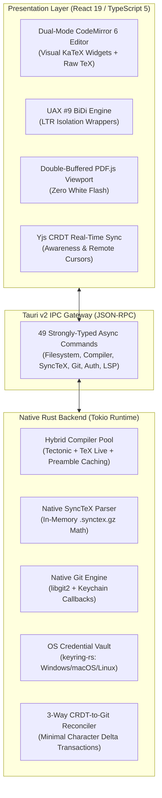

# LeafForge Documentation Suite

Welcome to the official technical documentation suite for **LeafForge**, the local-first collaborative LaTeX desktop studio.

---

## Documentation Index

| Guide | Description | Key Topics |
| :--- | :--- | :--- |
| [**System Architecture**](architecture.md) | Complete architectural design & system internals | Tauri v2 IPC boundary, Dual CodeMirror 6 BiDi/Visual engine, hybrid compiler pool, native libgit2 bridge, Yjs CRDT real-time network |
| [**Security Architecture**](security.md) | Deep dive into security measures & threat model | OS Keychain token storage via `keyring-rs`, GitHub OAuth Device Flow (RFC 8628), repository permission gating, WebRTC E2EE with Blake3 room keys |
| [**User Manual**](user-guide.md) | End-to-end user manual from A to Z | Installation (.msi, .dmg, .AppImage), GitHub login, project creation, dual Visual/Raw editing, Arabic/Hebrew BiDi writing, SyncTeX navigation, collaboration, Git 3-way merges |
| [**Developer Guide**](developer-guide.md) | Contributor onboarding & engineering handbook | Workspace bootstrap, running test suites (112 Vitest tests, Cargo check/clippy), packaging release binaries, extension recipes, commit standards |

---

## Architectural Highlights

---

## Core Guarantees
- **Single Source of Truth:** No destructive HTML conversions. Visual Mode directly projects widgets over the exact UTF-8 LaTeX source code.
- **Offline First:** Fully functional without an internet connection. Compiles locally using embedded Tectonic or system TeX distributions.
- **Hardware-Backed Credential Security:** GitHub OAuth tokens are encrypted directly inside your operating system's native credential locker.
- **Zero-Flicker PDF Viewing:** Dual canvas buffers eliminate screen flash when updating compiled documents.
