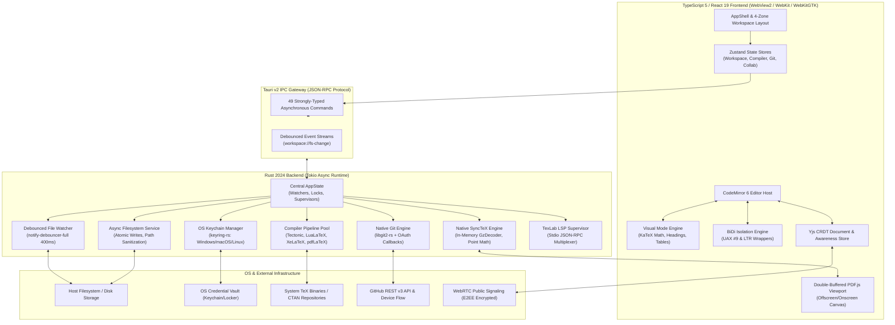
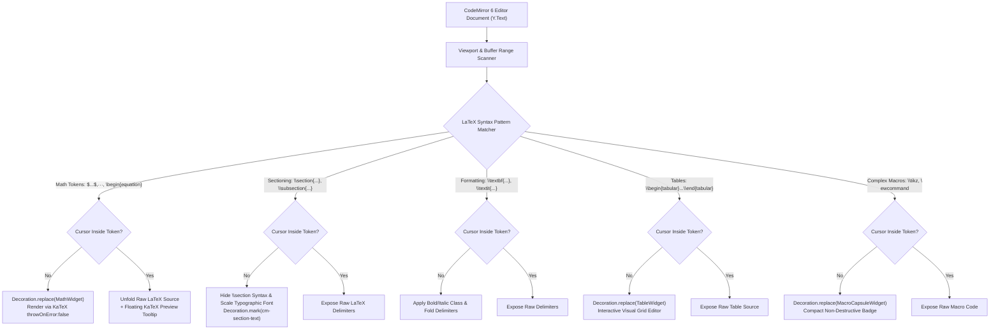
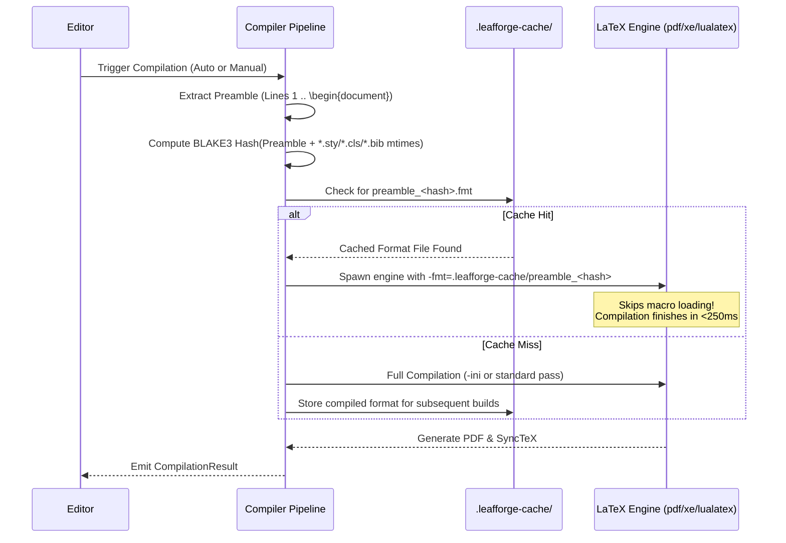
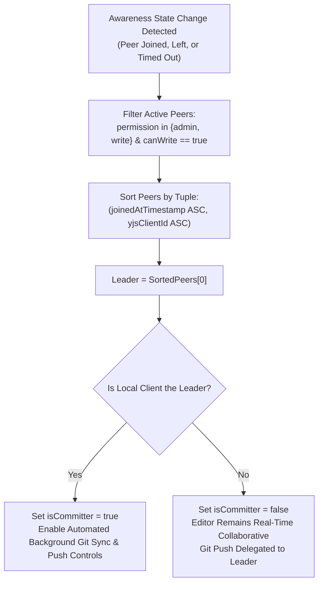
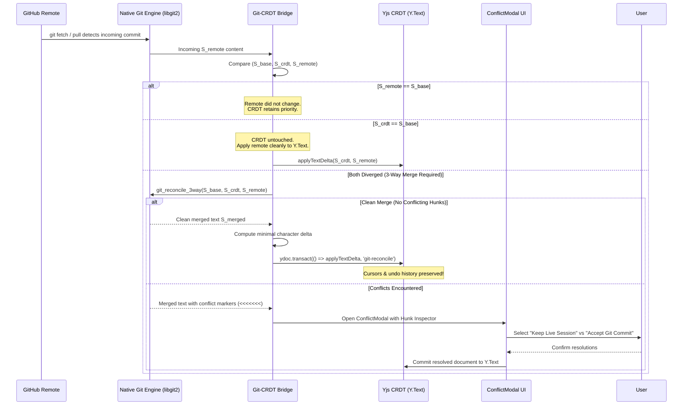

# LeafForge — System Architecture & Engine Design Specification

> **Status:** Production-Grade Reference  
> **Target Audience:** Systems Architects, Core Contributors, Security Engineers  
> **Cross-References:** [Security Architecture](security.md) | [User Manual](user-guide.md) | [Developer Guide](developer-guide.md)

---

## 1. Executive Overview & System Topology

LeafForge is a **local-first, desktop-native collaborative LaTeX Integrated Development Environment (IDE)** engineered as a high-performance alternative to browser-locked SaaS platforms like Overleaf. Traditional browser-based LaTeX platforms suffer from severe network latency, strict compile timeout quotas, vendor lock-in, and privacy vulnerabilities resulting from centralized cloud document storage.

LeafForge eliminates these limitations by pairing a desktop-native shell powered by **Tauri v2 (Rust 2024 Edition)** with an agile **React 19 / TypeScript 5** frontend. The architecture unites five foundational subsystems:
1. **Desktop Shell & IPC Gateway:** Multithreaded Tokio asynchronous runtime bridging native OS primitives to the webview via strongly-typed, memory-safe IPC.
2. **Dual-Mode Editor & BiDi Engine:** A unified CodeMirror 6 document projection system supporting seamless toggling between raw source code and rich visual WYSIWYM widgets, augmented with UAX #9 bidirectional paragraph detection and LTR command isolation.
3. **Hybrid LaTeX Compilation Pool:** An intelligent compiler dispatcher combining an embedded, zero-configuration Tectonic engine (with on-demand CTAN package fetching) with host TeX Live / MiKTeX installations (`pdflatex`, `xelatex`, `lualatex`), sub-second incremental preamble format caching, and native SyncTeX navigation.
4. **Native libgit2 Version Control Bridge:** Full Git repository operations implemented directly in Rust via `git2-rs`, authenticated against GitHub via OS Keychain-stored OAuth tokens.
5. **Yjs CRDT Real-Time Sync Network:** Peer-to-peer and relayed WebRTC/WebSocket collaboration featuring end-to-end encryption (E2EE), deterministic Designated Committer election, and an automated 3-way Git-CRDT reconciliation engine.



---

## 2. Tauri v2 Rust / TypeScript Boundary & IPC Choreography

### 2.1 Process Isolation & Threading Model
LeafForge strictly separates untrusted web presentation logic from native system privileges:
- **Renderer Thread:** Executes in the native platform webview (WebView2 on Windows, WebKit2 on macOS, WebKitGTK on Linux). The renderer holds zero direct access to raw sockets, native filesystems, or system memory pointers.
- **Tauri Core Runtime:** Runs on a dedicated multithreaded Tokio runtime. Blocking C-library calls (notably `git2` operations and synchronous file scanning) are offloaded to Tokio worker threads via `tokio::task::spawn_blocking` to prevent starving the asynchronous reactor.
- **Process Supervision:** External compiler processes (`tectonic`, `pdflatex`, `xelatex`, `lualatex`) and language servers (`texlab`) run as child processes monitored via asynchronous stdio pipes and cancellation channels.

### 2.2 Application State Architecture (`src-tauri/src/state.rs`)
The Rust backend maintains global singleton state across all Tauri IPC invocations:

```rust
pub struct AppState {
    pub current_workspace: Arc<RwLock<Option<PathBuf>>>,
    pub watcher_handle: Arc<Mutex<Option<WorkspaceWatcher>>>,
    pub lsp_supervisor: Arc<tokio::sync::Mutex<LspSupervisor>>,
    pub active_compile_abort: Arc<tokio::sync::Mutex<Option<tokio::sync::oneshot::Sender<()>>>>,
}
```

- `current_workspace`: Thread-safe reference to the active project root directory.
- `watcher_handle`: Manages the active `notify-debouncer-full` instance, dropped and reinstantiated upon workspace switches.
- `lsp_supervisor`: Controls the lifecycle, stdio communication channels, and document synchronization for the `texlab` language server.
- `active_compile_abort`: Holds a `tokio::sync::oneshot::Sender<()>` cancellation trigger. Spawning a new compilation atomically aborts any in-flight compiler process to maintain a responsive typing experience.

### 2.3 IPC Command Catalog (49 Registered Handlers)
All communication over the Tauri boundary uses strongly-typed JSON serializable payloads defined in Rust and mirrored in TypeScript (`src/types/ipc.ts`, `latex.ts`, `git.ts`):

| Domain | Rust Command | Arguments | Return Type | Architectural Role |
| :--- | :--- | :--- | :--- | :--- |
| **Filesystem** | `open_folder` | `path?: String` | `Option<String>` | Native folder selection dialog via `rfd` |
| | `list_files` | `dir_path: String` | `Vec<FileEntry>` | Recursive directory tree scan |
| | `read_file_text` | `path: String` | `String` | UTF-8 text reader with validation |
| | `write_file_text` | `path: String, content: String` | `()` | Atomic file write (temp file + rename) |
| | `create_file` | `path: String` | `()` | Creates empty document file |
| | `create_dir` | `path: String` | `()` | Recursive directory creation |
| | `rename_path` | `old_path: String, new_path: String` | `()` | Atomic path rename |
| | `delete_path` | `path: String` | `()` | Safe file or recursive folder removal |
| | `import_binary_asset` | `target_dir: String, source_path: String` | `String` | Validated asset import (`.png`, `.pdf`, `.eps`) |
| | `watch_directory` | `dir_path: String` | `()` | Initializes debounced filesystem watcher |
| | `unwatch_directory` | — | `()` | Terminates active filesystem watcher |
| **Compiler** | `compile_document` | `project_dir, root_file, engine, use_preamble_cache, timeout_secs` | `CompilationResult` | Spawns compiler with timeout & cancel token |
| | `detect_engines` | — | `Vec<EngineInfo>` | PATH and system scanning for TeX engines |
| | `abort_compilation` | — | `bool` | Triggers active cancellation channel |
| | `clean_aux_files` | `project_dir: String, root_filename: String` | `Vec<String>` | Purges `.aux`, `.log`, `.fls`, `.synctex(busy)` |
| | `parse_magic_comments`| `content: String` | `MagicComments` | Extracts `% !TEX program` and `% !TEX root` |
| **SyncTeX** | `synctex_forward` | `synctex_path, source_file, line, column` | `Option<SyncTexCoordinate>`| Converts file line/col to PDF page and point box |
| | `synctex_inverse` | `synctex_path, page, x, y` | `Option<SyncTexInverseResult>`| Converts PDF coordinate to source file line/col |
| **Fonts** | `list_system_fonts` | — | `Vec<SystemFontInfo>` | Queries OpenType/TrueType fonts via `fontdb` |
| | `list_font_families` | — | `Vec<String>` | Deduplicated system font families for UI picker |
| **Auth & Security** | `start_github_device_flow`| `client_id?: String` | `DeviceCodeResponse` | RFC 8628 Device Authorization initiation |
| | `poll_github_device_token`| `client_id?: String, device_code: String` | `PollTokenResponse` | Polls OAuth token and persists in OS Keychain |
| | `get_github_auth_status`| — | `AuthStatusResponse` | Checks OS Keychain and queries profile |
| | `get_github_user_profile`| — | `Option<GithubUserProfile>` | Queries GitHub `/user` profile |
| | `logout_github` | — | `()` | Purges OAuth token from OS Keychain |
| | `verify_repo_collaborator`| `owner, repo, username` | `CollaboratorPermission` | Checks GitHub Collaborator API permission gate |
| | `get_or_create_room_key`| `project_dir: String` | `String` | Retrieves or derives Blake3 256-bit E2EE room key |
| **Git Engine** | `git_init` | `path: String` | `()` | Initializes repository with default `main` branch |
| | `git_status` | `path: String` | `GitRepoStatus` | Working tree, index, ahead/behind calculation |
| | `git_diff` | `path: String, file_path: Option<String>`| `String` | Unified diff generation |
| | `git_stage` | `path: String, file_path: String` | `()` | Stages file in index |
| | `git_unstage` | `path: String, file_path: String` | `()` | Unstages file back to working tree |
| | `git_stage_all` | `path: String` | `()` | Stages all modified and untracked files |
| | `git_unstage_all` | `path: String` | `()` | Resets index to HEAD |
| | `git_commit` | `path: String, message: String` | `String` | Creates Git commit with user profile signature |
| | `git_clone` | `url, target_path, branch?` | `()` | Clones remote repo with Keychain credentials |
| | `git_push` | `path: String, remote?: String` | `()` | Pushes active branch with Keychain callbacks |
| | `git_pull` | `path: String, remote?: String` | `PullResult` | Fetches and fast-forwards remote branch |
| | `git_list_branches` | `path: String` | `Vec<String>` | Lists local Git branches |
| | `git_checkout_branch`| `path: String, branch_name: String` | `()` | Checks out target branch |
| | `git_reconcile_3way`| `base, crdt, remote` | `ReconcileResult` | Line-based 3-way merge between Git and CRDT |
| | `git_get_remote_url` | `path: String, remote?: String` | `Option<String>` | Reads configured remote URL |
| **LSP (TexLab)** | `lsp_start` | `root_path?: String` | `LspStatusResponse` | Spawns `texlab` process or embedded fallback |
| | `lsp_stop` | — | `()` | Shuts down active LSP supervisor |
| | `lsp_status` | — | `LspStatusResponse` | Queries LSP server health |
| | `lsp_did_open` | `uri: String, text: String` | `()` | Synchronizes opened document buffer |
| | `lsp_did_change` | `uri: String, text: String` | `()` | Synchronizes document text mutations |
| | `lsp_completion` | `uri: String, line: u32, character: u32` | `Vec<CompletionItem>` | BibTeX citations and macro completions |
| | `lsp_hover` | `uri: String, line: u32, character: u32` | `Option<HoverResponse>` | Documentation tooltips for LaTeX commands |

### 2.4 Unified Error Serialization (`src-tauri/src/error.rs`)
LeafForge enforces a **Zero `Result<T, String>` Policy**. All internal system errors are unified through `AppError` and serialized as structured JSON:

$$\text{ErrorPayload} = \left\{ \text{code}: \text{string}, \, \text{message}: \text{string}, \, \text{details}?: \text{string} \right\}$$

Supported error domains include `IO_ERROR`, `NOT_FOUND`, `INVALID_PATH`, `INVALID_ENCODING`, `UNSUPPORTED_ASSET`, `WATCHER_ERROR`, `COMPILER_ERROR`, `SYNCTEX_ERROR`, `FONT_ERROR`, `LSP_ERROR`, `AUTH_ERROR`, `KEYRING_ERROR`, `GIT_ERROR`, and `INTERNAL_ERROR`.

---

## 3. Dual-Mode CodeMirror 6 BiDi / Visual Editor Engine

### 3.1 Single-Source-of-Truth Principle
Traditional rich-text LaTeX editors convert LaTeX source code into intermediate HTML/ProseMirror structures and serialize back to text. This causes severe data corruption, formatting destruction, and loss of custom macros. 

LeafForge solves this with a **zero-destructive single-source-of-truth architecture**:
- The backing data structure is always the exact UTF-8 LaTeX source code stored in CodeMirror 6's `EditorState` and synchronized through Yjs's `Y.Text`.
- **Raw Mode** and **Visual Mode** are projections of the exact same data structure. Switching modes does not alter a single character of the document.
- Mode toggling is governed by `visualModeStateField` via `setVisualModeEffect(boolean)` without cursor or scroll displacement.

### 3.2 Visual Mode Projection Pipeline (`visualModePlugin.ts`)
When Visual Mode is active, an optimized `StateField<DecorationSet>` scans the visible viewport plus a 500-line buffer, generating atomic decorations:



#### Widget Specifications:
- **`MathWidget.ts`:** Renders KaTeX math directly into the document layout. If KaTeX encounters unsupported TeX macros, it catches the error gracefully and displays the syntax without crashing the editor. Clicking the widget moves the cursor inside the span, unfolding the raw TeX code instantly.
- **`SectionWidget.ts`:** Hides the syntactic tokens `\section{` and `}` when unfocused, scaling the heading typography according to academic hierarchy:
  - `\part`: `text-3xl font-extrabold`
  - `\chapter`: `text-2xl font-bold`
  - `\section`: `text-xl font-bold`
  - `\subsection`: `text-lg font-semibold`
  - `\subsubsection`: `text-base font-medium`
  - `\paragraph`: `text-sm font-bold`
- **`TableWidget.ts`:** Parses LaTeX tabular rows (`&` cell separators and `\\` row terminators) into an interactive HTML table grid. Users can edit cell contents, navigate via `Tab`, and add rows/columns; the widget writes back directly to the underlying LaTeX tokens.
- **`MacroCapsuleWidget.ts`:** Encapsulates TikZ picture environments and raw low-level macros (`\makeatletter ... \makeatother`) as compact, styled capsules to prevent visual clutter while preserving 100% of the code.

### 3.3 Bidirectional Text & LTR Isolation Engine (`bidiIsolation.ts`)
Academic writing in Semitic languages (Arabic, Hebrew, Persian, Urdu) frequently mixes right-to-left prose with left-to-right LaTeX markup, citations, and mathematical formulas. Without strict isolation, standard browser text engines erroneously mirror punctuation, brackets, and backslashes.

LeafForge implements a complete BiDi engine adhering to **Unicode Bidirectional Algorithm (UAX #9)**:
1. **Dynamic Direction Detection (UAX #9 Rule P2):**
   - Each paragraph line is scanned for its first strong directional character:
     - Strong RTL: Arabic (`\u0600-\u06FF`, `\u0750-\u077F`, `\uFB50-\uFDFF`), Hebrew (`\u0590-\u05FF`, `\uFB1D-\uFB4F`), Syriac (`\u0700-\u074F`).
     - Strong LTR: Basic Latin, Extended Latin, Greek, Cyrillic, CJK.
   - When RTL is detected, the line is marked with `dir="rtl"` and class `cm-rtl-line`.
2. **Strict LTR Command Isolation:**
   - Every LaTeX control sequence (e.g., `\cite{knuth84}`, `\ref{sec:intro}`, `\begin{equation}`) and math span (`$...$`, `$$...$$`) within an RTL line is dynamically wrapped in an LTR isolation decoration:
     ```css
     unicode-bidi: isolate;
     display: inline-block;
     direction: ltr;
     ```
   - This prevents mathematical operators ($=, +, -$) and braces (`{}`) from jumping visually to opposite ends of Arabic words.
3. **Manual Overrides:**
   - Users can manually force line direction via magic comments (`% !RTL` or `% !LTR`) or through the Command Palette shortcut (`Ctrl+Shift+R` / `Cmd+Shift+R`), tracked inside `manualLineDirectionField`.

---

## 4. Hybrid LaTeX Compilation Pool & Native SyncTeX Bridge

### 4.1 Multi-Engine Dispatcher (`compiler_pipeline.rs`)
LeafForge supports four compilation engines, selectable on a per-project basis:

| Engine | Binary | CTAN Strategy | SyncTeX Support | Primary Academic Use Case |
| :--- | :--- | :--- | :--- | :--- |
| **Tectonic** | `tectonic` | Automatic on-demand download into cache | Supported (`--synctex`) | Zero-setup default; portable XeTeX compilation without installing full TeX Live |
| **LuaLaTeX** | `lualatex` | System TeX Live / MiKTeX package tree | Supported (`-synctex=1`) | Modern multilingual typography, complex RTL scripts via `babel`, dynamic Lua scripts |
| **XeLaTeX** | `xelatex` | System TeX Live / MiKTeX package tree | Supported (`-synctex=1`) | Direct OpenType/TrueType system font access via `fontspec`, Polyglossia RTL |
| **pdfLaTeX** | `pdflatex` | System TeX Live / MiKTeX package tree | Supported (`-synctex=1`) | High-speed legacy compilation for standard IEEE, ACM, and arXiv templates |

### 4.2 Incremental Preamble Precompilation
LaTeX preamble parsing (macro definitions, `\usepackage` expansions, font metric loading) typically accounts for **60% to 75%** of overall compilation time. LeafForge implements an automated preamble format caching system:



The preamble cache hash $H$ is computed as:
$$H = \text{BLAKE3}\Big( \text{Content}_{\text{preamble}} \;\|\; \bigoplus_{f \in \{\text{local styles, classes, bibs}\}} \big(\text{Path}_f \;\|\; \text{MTime}_f\big) \Big)$$

If $H$ matches an existing `.fmt` file in `.leafforge-cache/`, the compiler is invoked with `-fmt=.leafforge-cache/preamble_<hash>`, reducing recompilation times from $1.8\text{ s}$ down to sub-$300\text{ ms}$.

### 4.3 Stateful LaTeX Log Parser (`log_parser.rs`)
Standard TeX compilers emit unstructured, deeply nested file logs. LeafForge includes a stateful parser that maintains an explicit file recursion stack:
- Tracks file open and close tokens: `(./sections/introduction.tex ... )`.
- Correlates errors (`! LaTeX Error:`, `! Undefined control sequence`, `file:line:error` format) to the exact source file even when multiple levels deep.
- Extracts warnings (`LaTeX Warning: Reference '...' on page ... undefined`, `Overfull \hbox (12.4pt too wide)`).
- Produces structured `LatexDiagnostic` records rendered as inline editor squiggles and filterable entries in `BuildLogDrawer.tsx`.

### 4.4 Native SyncTeX Two-Way Bridge (`synctex_parser.rs`)
LeafForge implements native, zero-external-dependency SyncTeX parsing in Rust:
1. **Decompression:** Directly decompresses `<root>.synctex.gz` into memory using `flate2::read::GzDecoder`.
2. **Coordinate Mathematics:** LaTeX outputs coordinates in TeX Scaled Points ($\text{sp}$), where $65536\text{ sp} = 1\text{ pt}$. Points are scaled to standard PDF points ($72\text{ dpi}$) using the factor:
   $$x_{\text{pdf}} = \frac{x_{\text{sp}}}{65536} \times \frac{72.0}{72.27} \times \frac{\text{Magnification}}{1000} + \text{XOffset}$$
3. **Forward Search (`synctex_forward`):** Translates an editor source location `(file, line, col)` into `{ page, x, y, width, height }`. The frontend scrolls `PdfViewport` and triggers a 1200ms translucent amber pulse overlay.
4. **Inverse Search (`synctex_inverse`):** Translates a `Ctrl+Click` / `Cmd+Click` at PDF coordinates `(page, x, y)` back into `{ file, line, column }`, automatically navigating the editor to the exact line and centering the viewport.

### 4.5 Flicker-Free Double-Buffered PDF Viewport (`PdfViewport.tsx`)
To eliminate the jarring white flash characteristic of traditional web-based PDF re-renders, LeafForge uses a double-buffered canvas architecture:
- Maintains two distinct HTML5 canvas buffers: **Buffer A (Active Visible)** and **Buffer B (Staging Offscreen)**.
- When compilation succeeds, the new PDF binary is loaded into a background `pdfjs-dist` worker.
- Buffer B renders the updated pages offscreen at the exact current scroll offset and zoom factor.
- On `requestAnimationFrame`, Buffer B is atomically swapped into visibility, and the previous buffer is disposed of with zero layout shift or white flicker.

---

## 5. Native libgit2 Version Control Bridge

### 5.1 Architecture & Authenticated Remote Callbacks (`git_engine.rs`)
Rather than relying on shell execution of the system `git` CLI (which can fail due to environment variances or missing binaries), LeafForge links natively against **`libgit2`** via `git2-rs` with vendored C sources and HTTPS transport.

All remote operations (`clone`, `fetch`, `push`, `pull`) authenticate via dynamic `RemoteCallbacks`:
```rust
fn make_callbacks() -> RemoteCallbacks<'static> {
    let mut callbacks = RemoteCallbacks::new();
    callbacks.credentials(|_url, _username_from_url, _allowed_types| {
        if let Ok(Some(token)) = GithubAuthService::get_token() {
            Cred::userpass_plaintext("x-access-token", &token)
        } else {
            Cred::default()
        }
    });
    callbacks
}
```
The token is retrieved in-memory from the OS Keychain at runtime and passed via `x-access-token` basic HTTP authentication over TLS.

### 5.2 Atomic Version Control Operations
The Git engine exposes a complete suite of repository management features:
- **Repository Discovery & Init:** `open()` discovers parent repositories; `init()` bootstraps repositories with a default `main` branch.
- **Working Tree Inspection:** Scans index, unstaged modifications, and untracked files, computing exact `ahead` and `behind` commit deltas against tracking branches.
- **Unified Diff Generation:** Generates syntax-highlighted diff hunks for inspection in `GitControlPanel.tsx`.
- **Atomic Staging & Commits:** Supports granular file staging, bulk staging, and programmatic commit creation with automated author signatures.
- **Safe Pull & Push:** Performs fast-forward merges when possible, or reports merge obligations to the reconciliation engine.

---

## 6. Yjs CRDT Real-Time Sync Network & 3-Way Git Reconciler

### 6.1 Hybrid Collaboration Topology
LeafForge combines peer-to-peer real-time co-editing with asynchronous Git version control:
- **Real-Time Data Layer:** Built on **Yjs**, an operation-based Conflict-free Replicated Data Type (CRDT). Document mutations are represented as monotonic state vectors that converge deterministically across distributed peers without central coordination.
- **Transport Layer:** Uses `y-webrtc` for zero-latency direct peer mesh connections, backed by public or custom signaling servers (`wss://signaling.yjs.dev`). Optional `y-websocket` providers are supported for environments restricting WebRTC UDP traffic.
- **Local Crash Persistence:** `y-indexeddb` persists uncommitted CRDT document updates locally, ensuring zero data loss even if the desktop application is suddenly closed.

### 6.2 Designated Committer Election Algorithm (`collabManager.ts`)
When multiple researchers edit a shared repository concurrently, uncoordinated Git commits would cause severe push collisions. LeafForge resolves this through an automated, deterministic **Designated Committer Election**:



The leader is chosen deterministically as:
$$\text{Leader} = \arg\min_{p \in \text{ActiveWritePeers}} \big(p.\text{joinedAt}, \; p.\text{clientId}\big)$$

If the designated leader disconnects, the awareness protocol detects the missing heartbeat within $3,000\text{ ms}$ and seamlessly promotes the next eligible peer.

### 6.3 3-Way CRDT-to-Git Reconciliation Protocol (`gitCrdtBridge.ts`)
When an external Git commit arrives from GitHub (e.g., pushed by a colleague using the command line or another branch), the system must merge it into the active live Yjs session without losing uncommitted character keystrokes or cursor positions.

LeafForge tracks three distinct states per file:
1. $S_{\text{base}}$: The exact text content at `HEAD` when the collaborative session initialized.
2. $S_{\text{crdt}}$: The live string serialized from `Y.Text.toString()`.
3. $S_{\text{remote}}$: The incoming string from the newly fetched Git remote commit.



#### Minimal Character Delta Algorithm (`applyTextDelta`):
Rather than wiping and replacing `Y.Text` (which would invalidate remote peer selection ranges and destroy undo history), `applyTextDelta` computes common prefixes and suffixes:
1. $P = \text{LongestCommonPrefix}(S_{\text{old}}, S_{\text{new}})$
2. $S = \text{LongestCommonSuffix}(S_{\text{old}}[|P|:], S_{\text{new}}[|P|:])$
3. Delete count: $|S_{\text{old}}| - |P| - |S|$
4. Insert slice: $S_{\text{new}}[|P| : |S_{\text{new}}| - |S|]$
5. Applies the transformation in a single scoped transaction:
   ```typescript
   ydoc.transact(() => {
     if (deleteCount > 0) ytext.delete(start, deleteCount);
     if (insertText.length > 0) ytext.insert(start, insertText);
   }, 'git-reconcile');
   ```

---

## 7. Performance Budget & Verification Specifications

LeafForge enforces strict mathematical performance boundaries across the entire system lifecycle:
- **Editor & UI Frame Budget:** $\le 16.6\text{ ms}$ per frame ($60\text{ FPS}$ sustained). Long tasks or synchronous regex sweeps over $10,000$ lines are strictly banned from the main thread.
- **Preamble-Cached Recompilation:** $\le 350\text{ ms}$ for typical academic papers when preamble formatting hash matches cache.
- **SyncTeX Lookup Latency:** $\le 25\text{ ms}$ for forward search and inverse search queries on decompressed `.synctex` records.
- **CRDT Synchronization Latency:** $\le 50\text{ ms}$ over local WebRTC mesh connections; $\le 150\text{ ms}$ over global relayed signaling.
- **Memory Footprint:** $\le 180\text{ MB}$ baseline idle memory footprint for the Tauri host process.
