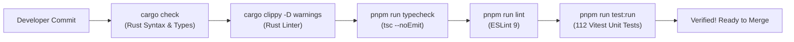

# LeafForge — Developer Onboarding & Engineering Handbook

> **Status:** Production-Grade Developer Reference  
> **Target Audience:** Core Contributors, System Engineers, Frontend Developers  
> **Cross-References:** [System Architecture](architecture.md) | [Security Architecture](security.md) | [User Manual](user-guide.md)

---

## 1. Codebase Architecture & Technology Map

LeafForge is structured as a modern monorepo combining a **Rust 2024 Edition** native backend (`src-tauri/`) and a **React 19 / TypeScript 5** frontend (`src/`):

```text
leafforge/
├── package.json               # Frontend dependencies & workspace scripts
├── pnpm-lock.yaml             # Strict deterministic dependency lockfile
├── tsconfig.json              # TypeScript 5.7 strict configuration
├── vite.config.ts             # Vite 6 bundler configuration with Tailwind 4
├── vitest.config.ts           # Vitest unit & component test configuration
├── specs.md                   # Master technical specifications & roadmap
├── docs/                      # Comprehensive documentation suite
├── src/                       # Frontend Application (React 19 + TypeScript)
│   ├── App.tsx                # Main AppShell and provider orchestrator
│   ├── main.tsx               # Webview DOM entrypoint
│   ├── editor/                # CodeMirror 6 LaTeX & Visual engine
│   │   ├── LatexEditor.tsx    # CodeMirror 6 host component
│   │   ├── extensions/        # BiDi, VisualMode, Diagnostics, SyncTeX, LSP
│   │   └── widgets/           # MathWidget, SectionWidget, TableWidget, MacroCapsule
│   ├── services/              # Client services (tauriClient, collabManager, gitCrdtBridge)
│   ├── store/                 # Zustand atomic state stores (workspace, compiler, git, collab)
│   ├── components/            # React UI components (layout, sidebar, pdf, diagnostics, modals)
│   ├── styles/                # Tailwind v4 globals & dual theme token definitions
│   ├── types/                 # Strict TypeScript mirrors of Rust structs/enums
│   └── __tests__/             # Comprehensive Vitest test suite (112 unit tests)
└── src-tauri/                 # Native Desktop Host (Rust 2024 / Tauri v2)
    ├── Cargo.toml             # Rust dependencies & optimization profiles
    ├── tauri.conf.json        # Tauri v2 application configuration & bundle rules
    ├── capabilities/          # Tauri v2 security capabilities (default.json)
    └── src/
        ├── lib.rs             # Tauri application runner & 49 registered IPC commands
        ├── main.rs            # Desktop executable entrypoint
        ├── state.rs           # Thread-safe global AppState
        ├── error.rs           # Unified AppError & serializable AppErrorPayload
        ├── commands/          # Modular IPC handlers (fs, compiler, git, auth, synctex, font, lsp)
        └── services/          # Low-level systems services (git2, tectonic, synctex, watcher, lsp)
```

---

## 2. Prerequisites & Environment Setup

### 2.1 Core Toolchains
Ensure the following tools are installed on your workstation:
1. **Node.js:** `v20.x` or `v22.x` (LTS recommended).
2. **Package Manager:** `pnpm` (v9 or v10). Install via `corepack enable pnpm` or `npm install -g pnpm`.
3. **Rust Toolchain:** Rust `1.85+` (2024 Edition). Install via [rustup](https://rustup.rs):
   ```bash
   rustup update stable
   rustup default stable
   ```

### 2.2 Platform-Specific Native Dependencies

#### Windows
- **C++ Build Tools:** Visual Studio 2022 C++ Build Tools (with "Desktop development with C++").
- **WebView2:** Installed by default on Windows 10/11.
- **Git:** Git for Windows.

#### macOS
- **Xcode Command Line Tools:**
  ```bash
  xcode-select --install
  ```

#### Linux (Debian / Ubuntu)
Install system libraries required for WebKitGTK and native compilation:
```bash
sudo apt update
sudo apt install -y \
  build-essential \
  curl \
  wget \
  file \
  libssl-dev \
  libgtk-3-dev \
  libwebkit2gtk-4.1-dev \
  libayatana-appindicator3-dev \
  librsvg2-dev \
  libxdo-dev
```

### 2.3 Optional LaTeX Toolchains (for Full Local Pipeline Testing)
- **Tectonic:** `cargo install tectonic`
- **TexLab (Language Server):** Available via package managers or GitHub releases:
  - macOS: `brew install texlab`
  - Windows: `scoop install texlab` or `choco install texlab`
  - Arch Linux: `pacman -S texlab`

---

## 3. Workspace Bootstrap & Local Development

### 3.1 Clone & Install Dependencies
Clone the repository and install all frontend packages:
```bash
git clone https://github.com/leafforge/leafforge.git
cd leafforge
pnpm install
```

### 3.2 Launching the Local Development Environment
LeafForge supports two development modes:

#### 1. Full Desktop Development (Recommended)
Spawns the Vite hot-module-reloading dev server and the native Tauri v2 desktop window:
```bash
pnpm tauri dev
```
- Vite dev server runs at `http://localhost:1420`.
- Tauri launches the desktop webview with developer tools enabled.
- Modifying React files in `src/` triggers instant hot-reloading.
- Modifying Rust files in `src-tauri/src/` automatically triggers incremental recompilation of the host binary.

#### 2. Browser Preview Mode (Mock IPC)
For rapid UI styling and frontend component development without compiling Rust:
```bash
pnpm dev
```
In browser mode, `tauriClient.ts` detects non-Tauri environments (`isTauriEnvironment() === false`) and activates embedded mocks for filesystem and compiler operations.

---

## 4. Testing, Linting & Verification Suite

LeafForge enforces a **Compile-Before-Commit Gate**. Every pull request and release commit must pass the complete verification suite with zero errors and zero warnings.



### 4.1 Running Frontend Verification
```bash
# 1. Typecheck the entire TypeScript codebase
pnpm run typecheck

# 2. Run ESLint across all files
pnpm run lint

# 3. Execute all unit and component tests
pnpm run test:run
```

#### Test Suite Breakdown (17 Test Suites, 112 Tests Passed):
- `src/__tests__/smoke.test.ts`: Workspace initial state and IPC client detection.
- `src/__tests__/bidiComprehensive.test.ts`: Unicode UAX #9 paragraph direction and token regex tests.
- `src/__tests__/visualMode.test.ts`: KaTeX math widgets, section typography scaling, and table widgets.
- `src/__tests__/reconciler.test.ts`: 3-way Git-CRDT reconciliation, minimal delta algorithm, conflict hunks.
- `src/__tests__/crdtGitMergeComprehensive.test.ts`: Edge-case merges, divergent branches, and resolution assembly.
- `src/__tests__/collab.test.ts`: CollabManager lifecycle, GitHub collaborator permission gating, and room keys.
- `src/__tests__/synctex.test.ts`: Scaled point conversion, in-memory decompression, forward/inverse coordinate math.
- `src/__tests__/commandPalette.test.tsx`: Command palette keyboard interactions and fuzzy search.
- `src/__tests__/logParser.test.ts`: Stateful TeX log parser, error diagnostics, and bad box detection.
- `src/__tests__/git.test.tsx`: Git staging sidebar, diff inspector, and branch switching.
- `src/__tests__/auth.test.ts`: GitHub OAuth Device Flow state machine and polling.

### 4.2 Running Backend Rust Verification
```bash
# 1. Fast compile check
cargo check --manifest-path src-tauri/Cargo.toml

# 2. Strict linter check (denies all warnings)
cargo clippy --manifest-path src-tauri/Cargo.toml -- -D warnings

# 3. Native Rust unit tests
cargo test --manifest-path src-tauri/Cargo.toml
```

---

## 5. Building Release Binaries & Installers

To package production-grade desktop installers for distribution:

```bash
pnpm tauri build
```

This command executes `pnpm build` (compiling TypeScript and bundling Vite assets into `dist/`) followed by `cargo build --release` with aggressive compiler optimizations configured in `src-tauri/Cargo.toml`:
- `codegen-units = 1`
- `lto = true` (Link-Time Optimization)
- `opt-level = 3` (Maximum optimization)
- `panic = "abort"`
- `strip = true` (Strips debug symbols to minimize binary size)

### Generated Platform Bundles:
- **Windows:**
  - `src-tauri/target/release/bundle/msi/LeafForge_0.1.0_x64_en-US.msi` (WiX installer)
  - `src-tauri/target/release/bundle/nsis/LeafForge_0.1.0_x64-setup.exe` (NSIS installer)
- **macOS:**
  - `src-tauri/target/release/bundle/dmg/LeafForge_0.1.0_aarch64.dmg` (Apple Silicon)
  - `src-tauri/target/release/bundle/macos/LeafForge.app`
- **Linux:**
  - `src-tauri/target/release/bundle/appimage/leafforge_0.1.0_amd64.AppImage`
  - `src-tauri/target/release/bundle/deb/leafforge_0.1.0_amd64.deb`

---

## 6. Codebase Extension Recipes

### Recipe A: Adding a New Tauri IPC Command
To add a new native capability (e.g., exporting a document as a `.zip` archive):

1. **Implement the Async Command in Rust (`src-tauri/src/commands/fs_cmds.rs`):**
   ```rust
   #[tauri::command]
   pub async fn export_project_zip(project_dir: String, target_zip_path: String) -> Result<()> {
       tokio::task::spawn_blocking(move || {
           // Perform zip archiving on background thread
           Ok(())
       }).await.map_err(|e| AppError::Internal(e.to_string()))?
   }
   ```
2. **Register Command in `src-tauri/src/lib.rs`:**
   Add `export_project_zip` to `tauri::generate_handler![...]`.
3. **Define TypeScript Types in `src/types/ipc.ts`:**
   Add any structured request/response payload interfaces.
4. **Expose Typed Wrapper in `src/services/tauriClient.ts`:**
   ```typescript
   export async function exportProjectZip(projectDir: string, targetZipPath: string): Promise<void> {
     return invoke<void>('export_project_zip', { projectDir, targetZipPath });
   }
   ```

### Recipe B: Adding a New CodeMirror 6 Visual Widget
To render a new syntactic element visually (e.g., custom `\begin{algorithm}` environments):

1. **Create the Widget Class (`src/editor/widgets/AlgorithmWidget.ts`):**
   ```typescript
   import { WidgetType } from '@codemirror/view';

   export class AlgorithmWidget extends WidgetType {
     constructor(readonly content: string) {
       super();
     }

     toDOM(): HTMLElement {
       const dom = document.createElement('div');
       dom.className = 'cm-algorithm-box border border-amber-500/30 bg-amber-500/5 p-4 rounded-lg my-2';
       dom.innerHTML = `<span class="text-xs uppercase font-bold text-amber-500">Algorithm</span><pre>${this.content}</pre>`;
       return dom;
     }

     eq(other: AlgorithmWidget) {
       return other.content === this.content;
     }
   }
   ```
2. **Register Matcher in `src/editor/extensions/visualModePlugin.ts`:**
   Add regex pattern and push `Decoration.replace({ widget: new AlgorithmWidget(match[0]), block: true })` into `entries`.
3. **Write Verification Test:** Add test case in `src/__tests__/visualMode.test.ts`.

---

## 7. Contribution Guidelines & Commit Standards

### 7.1 Conventional Commits
All commits must follow the **Conventional Commits** specification:
- `feat(<subsystem>): <imperative description>`
- `fix(<subsystem>): <imperative description>`
- `test(<subsystem>): <imperative description>`
- `docs(<subsystem>): <imperative description>`
- `chore(<subsystem>): <imperative description>`

#### Approved Scopes:
`editor`, `visual-mode`, `bidi`, `compiler`, `synctex`, `diagnostics`, `pdf`, `git`, `auth`, `collab`, `reconciler`, `lsp`, `ui`, `fs`.

### 7.2 Zero-Placeholder Policy
- Never commit `// TODO`, `// FIXME`, `unimplemented!()`, `todo!()`, or mock stub functions.
- Every function, struct, and command must be wired to the application and covered by automated tests.
- Maintain a $60\text{ FPS}$ frame budget ($\le 16.6\text{ ms}$) in all frontend extensions.
