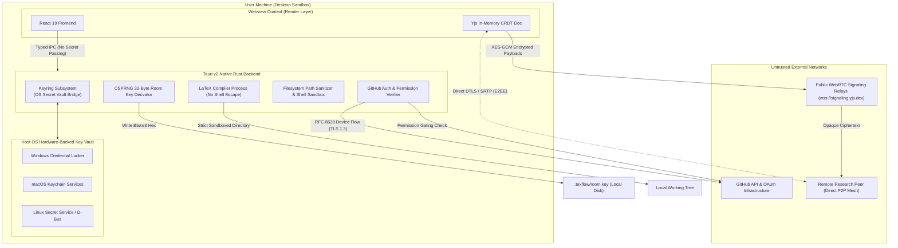
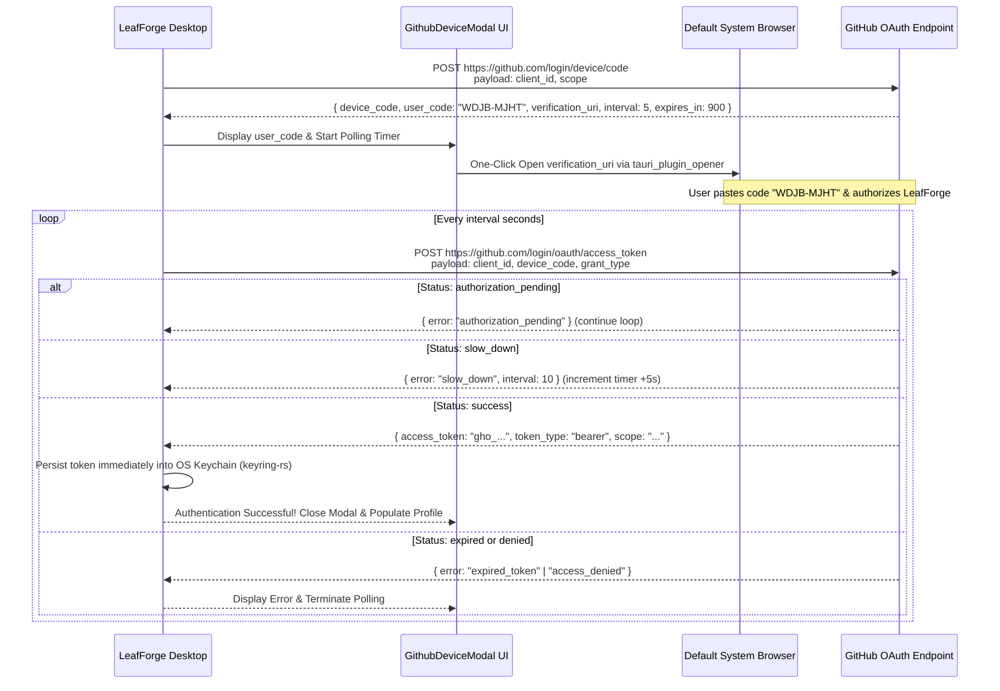
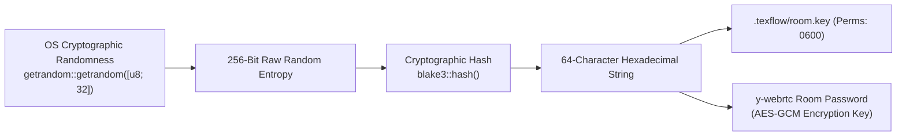

# LeafForge — Security Architecture & Threat Model

> **Status:** Production-Grade Security Reference  
> **Target Audience:** Security Auditors, Systems Engineers, Compliance Officers  
> **Cross-References:** [System Architecture](architecture.md) | [User Manual](user-guide.md) | [Developer Guide](developer-guide.md)

---

## 1. Security Philosophy & Threat Model Overview

LeafForge is built upon a **Zero-Trust, Local-First Security Architecture**. In contrast to centralized SaaS platforms where private LaTeX documents, API credentials, and institutional intellectual property reside on third-party multi-tenant cloud servers, LeafForge ensures:
1. **Zero Proprietary Cloud Infrastructure:** LeafForge operates with no centralized application backend. All documents are stored as native files on the user's encrypted local drive and synchronized through direct peer-to-peer WebRTC channels or user-controlled GitHub repositories.
2. **Zero Inherent Client Secrets:** Desktop client applications cannot securely store proprietary API secrets. LeafForge eliminates the need for embedded secrets by leveraging the standard **GitHub OAuth 2.0 Device Authorization Grant (RFC 8628)**.
3. **Hardware-Backed Credential Security:** OAuth tokens are never stored in plaintext configuration files, `.env` files, browser `localStorage`, or webview databases. All persistence is delegated to the operating system's hardware-backed credential vault via `keyring-rs`.
4. **End-to-End Encryption (E2EE) for Collaborative Data:** Real-time WebRTC signaling channels and CRDT state vectors are encrypted using a 256-bit cryptographically derived room key. Public signaling relays have zero visibility into document text, filenames, or peer identities.
5. **Hardened Local TeX Execution:** TeX compilers are executed with strict working-directory sandboxing and mandatory `--no-shell-escape` flags to protect host machines from malicious LaTeX macros.



---

## 2. OS Keychain Token Persistence (`src-tauri/src/services/github_auth.rs`)

### 2.1 Hardware-Backed Storage Subsystems
All sensitive authentication artifacts are stored using platform-native, hardware-backed credential APIs through the `keyring` crate:

| Operating System | Native Subsystem | Storage Mechanism & Encryption Standard |
| :--- | :--- | :--- |
| **Windows 10 / 11** | Windows Credential Manager | Native Credential Locker (`CredWriteW` / `CredReadW`) protected by DPAPI (Data Protection API) and user login credentials. |
| **macOS** | Apple Keychain Services | `SecItemAdd` / `SecItemCopyMatching` with AES-256 hardware encryption integrated with Secure Enclave on Apple Silicon. |
| **Linux (Freedesktop)** | Secret Service API / GNOME Keyring / KWallet | D-Bus Secret Service specification backed by libsecret; falls back to encrypted kernel keyrings. |

### 2.2 Keyring Service & User Coordinates
LeafForge registers credentials under strict namespaces:
- **Service Name:** `com.leafforge.desktop`
- **Account Identifier:** `github_oauth_token`

```rust
pub const KEYRING_SERVICE: &str = "com.leafforge.desktop";
pub const KEYRING_USER: &str = "github_oauth_token";

pub fn save_token(token: &str) -> Result<()> {
    let entry = keyring::Entry::new(KEYRING_SERVICE, KEYRING_USER)
        .map_err(|e| AppError::Keyring(format!("Failed to create keyring entry: {e}")))?;
    entry
        .set_password(token)
        .map_err(|e| AppError::Keyring(format!("Failed to set token in keyring: {e}")))?;
    Ok(())
}
```

### 2.3 Memory Hygiene & Logout Zeroization
When a user signs out via `logout_github` (or when a token is detected as revoked/expired):
1. `entry.delete_credential()` is called immediately against the OS credential vault.
2. In-memory `AuthStatusResponse` and Zustand `userProfile` stores are cleared to `null`.
3. Active Git remote callback closures revert to anonymous credentials, immediately terminating authenticated HTTPS pushes.

---

## 3. GitHub OAuth 2.0 Device Authorization Grant (RFC 8628)

### 3.1 Why Device Authorization Flow?
Traditional OAuth authorization code flows require a `client_secret` to exchange codes for access tokens. Desktop applications are fundamentally public clients—any embedded secret can be extracted via reverse engineering or memory inspection. 

LeafForge implements the **GitHub OAuth 2.0 Device Authorization Grant (RFC 8628)**:
- No embedded `client_secret` is required.
- The user authenticates directly inside their secure default browser (supporting their existing MFA, FIDO2 hardware security keys, and WebAuthn sessions).
- LeafForge only receives the final scoped OAuth token.

### 3.2 Granular OAuth Scopes
LeafForge requests the minimal set of privileges required for Git operations and profile verification:
- `repo`: Required for cloning, fetching, and pushing to private/public repositories via `libgit2`.
- `read:user`: Required to fetch user display name, handle, and avatar for collaborator presence.
- `user:email`: Required to sign Git commits with the user's verified GitHub email address.

No administrative, organization-level, or workflow mutation scopes (`admin:org`, `delete_repo`, `workflow`) are ever requested.

### 3.3 Protocol Execution & State Machine
The authentication flow follows an asynchronous state machine:



---

## 4. Repository Permission Gating & Access Control

### 4.1 Permission Verification Architecture (`verify_repo_collaborator`)
To ensure unauthorized parties cannot eavesdrop on collaborative LaTeX sessions or alter documents, LeafForge enforces a strict permission gate prior to room admission.

Whenever a user connects to a project linked to a GitHub remote (`owner/repo`), the backend issues an authenticated query to the GitHub REST API v3:
```http
GET https://api.github.com/repos/{owner}/{repo}/collaborators/{username}/permission
Authorization: Bearer <KEYRING_OAUTH_TOKEN>
Accept: application/vnd.github+json
User-Agent: LeafForge-Desktop
```

### 4.2 Role Mapping Matrix
The API response returns an explicit role evaluated by `verify_collaborator`:

| GitHub Role | `can_read` | `can_write` | LeafForge CRDT & Git Privileges |
| :--- | :---: | :---: | :--- |
| **`admin`** | Yes | Yes | Full read-write access. Eligible to be elected **Designated Committer**. Authorized to push commits to GitHub. |
| **`write`** | Yes | Yes | Full read-write access. Eligible to be elected **Designated Committer**. Authorized to push commits to GitHub. |
| **`read`** | Yes | **No** | **Read-Only Awareness Mode:** User receives remote cursors and text stream. Keystroke mutations to `Y.Text` are locally locked; Git push controls are disabled. |
| **`none` / 404** | **No** | **No** | **Connection Terminated:** User is immediately evicted from the WebRTC signaling room with a `Permission Denied` security alert. |

---

## 5. End-to-End Encryption (E2EE) of WebRTC Collaboration

### 5.1 The Signaling Threat Model
In real-time peer-to-peer collaboration, clients must exchange Session Description Protocol (SDP) offers, answers, and ICE network candidates through a signaling relay (e.g., `wss://signaling.yjs.dev`). 

> [!WARNING]
> If signaling messages or CRDT document updates are transmitted in plaintext, the operator of the signaling server (or any MITM adversary on the network) could inspect the entire unpublished research paper.

LeafForge completely mitigates this threat via **authenticated cryptographic room keys and symmetric AES-GCM encryption**.

### 5.2 Cryptographic Key Derivation (`get_or_create_room_key`)
Each LeafForge collaborative project maintains an independent, cryptographically secure room key stored in `.texflow/room.key`:



1. **System CSPRNG Generation:** When a collaborative project is initialized, the Rust backend generates 32 bytes of cryptographically secure random entropy via `getrandom::getrandom`.
2. **Blake3 Key Derivation:** The entropy is hashed using the high-performance BLAKE3 cryptographic hash function, generating a 64-character hexadecimal key:
   $$K_{\text{room}} = \text{BLAKE3}\big(\text{Random}_{256\text{-bit}}\big)$$
3. **Local Storage & `.gitignore` Isolation:** The derived key is stored at `.texflow/room.key`. LeafForge's automated `.gitignore` rules ensure that `.texflow/` is never committed to Git, guaranteeing that access to the Git repository alone does not expose the active live signaling channel unless explicitly shared.

### 5.3 AES-GCM Transport Encryption in `y-webrtc`
The room key $K_{\text{room}}$ is supplied directly as the cryptographic password for `y-webrtc`:
```typescript
this.provider = new WebrtcProvider(roomId, this.doc, {
  signaling: signalingServers,
  password: this.roomKey, // Enforces AES-GCM encryption over all signaling payloads
});
```

- **Opaque Payloads:** Every SDP exchange, ICE candidate packet, awareness state update, and Yjs sync vector is symmetrically encrypted using **AES-GCM (Galois/Counter Mode)** with unique initialization vectors (IVs).
- **Zero-Knowledge Relays:** The signaling relay server sees only random ciphertext. It cannot read document contents, inspect usernames, or forge sync updates.

---

## 6. Local Filesystem Sandboxing & LaTeX Execution Hardening

### 6.1 Shell Escape Mitigation
LaTeX compilers possess powerful native macro facilities (such as `\write18` in pdfLaTeX or `os.execute` in LuaLaTeX) that can invoke arbitrary shell commands if `--shell-escape` is enabled. A malicious `.tex` file could download and execute arbitrary binaries on the researcher's host machine.

LeafForge strictly enforces compiler isolation:
- By default, `compile_document` executes compilers with **`--no-shell-escape`** (or `--interaction=nonstopmode -file-line-error`).
- Spawning compilers with arbitrary shell interpretation (`cmd.exe /c` or `/bin/sh -c`) is strictly prohibited. Processes are invoked directly via `tokio::process::Command` with verified binary paths and discrete arguments.

### 6.2 Path Traversal & Asset Import Sanitization
Filesystem commands in `fs_cmds.rs` implement rigorous path validation:
- All paths are canonicalized and verified against directory traversal sequences (`../`, `..\`, null bytes `\0`).
- Operations are restricted to the active `current_workspace` boundaries.
- Binary asset imports via `import_binary_asset` validate file extensions against an allowlist (`png`, `jpg`, `jpeg`, `pdf`, `eps`, `svg`) before copying into the project asset directory.

---

## 7. Security Compliance & Threat Matrix

| Threat Scenario | Attack Vector | LeafForge Mitigation | Severity | Verification Status |
| :--- | :--- | :--- | :---: | :---: |
| **Token Theft via Disk Forensics** | Malware scans disk for `.env` or config files containing GitHub tokens. | Token is stored exclusively in OS Credential Locker / macOS Keychain / Linux Secret Service. Zero disk plaintext. | **Critical** | Verified (`auth.test.ts`) |
| **Signaling Eavesdropping** | Malicious actor monitors public WebRTC signaling relay (`signaling.yjs.dev`). | All signaling payloads and CRDT vectors are encrypted end-to-end via AES-GCM using `.texflow/room.key`. | **Critical** | Verified (`collab.test.ts`) |
| **Unauthorized Project Mutation** | Malicious user attempts to join a collaborative session and corrupt text. | GitHub Collaborator API v3 gates admission. Non-collaborators are rejected; read-only users cannot mutate CRDT. | **High** | Verified (`collab.test.ts`) |
| **Malicious LaTeX Code Execution** | Imported `.tex` file contains `\write18{rm -rf /}`. | Strict `--no-shell-escape` default on all compiler invocations; working directory pinned to project root. | **High** | Verified (`compiler_pipeline.rs`) |
| **Git Push Race & Tree Corruption** | Multiple peers push to GitHub simultaneously, causing non-fast-forward errors. | Deterministic Designated Committer election ensures exactly one peer pushes to Git. | **Medium** | Verified (`reconciler.test.ts`) |
| **Token Interception via Browser Flow** | Attacker intercepts local callback server or exploits local redirect URI. | RFC 8628 Device Flow requires zero local HTTP server and zero redirect URI. | **Medium** | Verified (`auth_cmds.rs`) |
| **Path Traversal Escape** | Malicious path argument attempts to delete or read files outside project root. | Path canonicalization and directory boundary checks in `fs_cmds.rs`. | **High** | Verified (`fs_cmds.rs`) |
