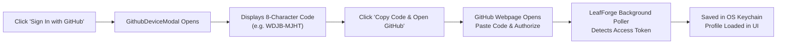
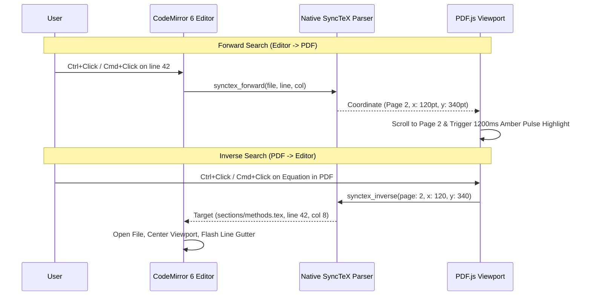
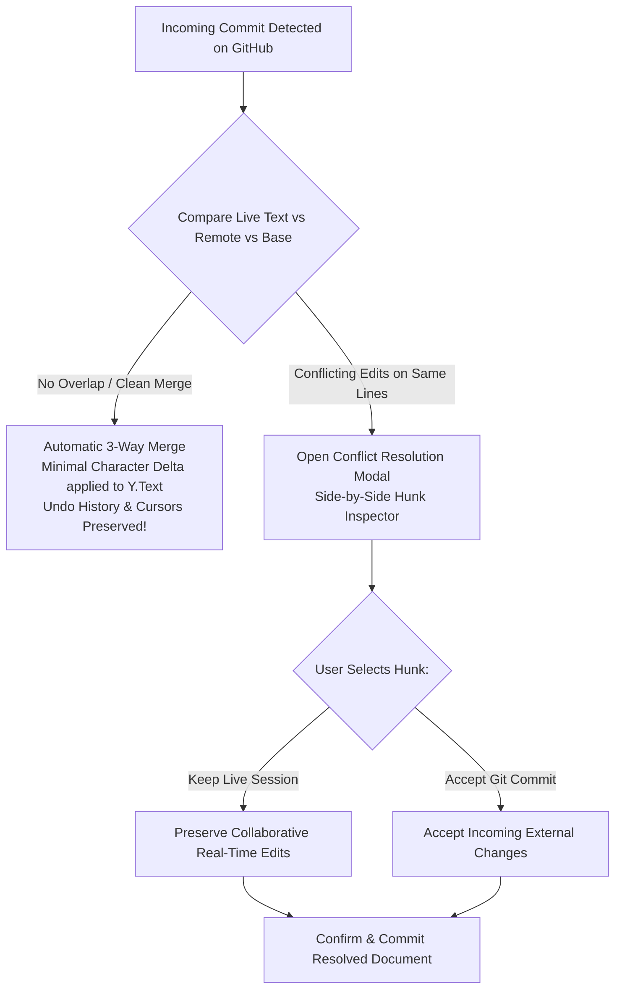

# LeafForge — User Manual & Operations Guide

> **Application:** LeafForge Desktop IDE (v0.1.0)  
> **Target Audience:** Researchers, Academics, Students, TeX Authors  
> **Cross-References:** [System Architecture](architecture.md) | [Security Architecture](security.md) | [Developer Guide](developer-guide.md)

---

## 1. Introduction & Core Capabilities

Welcome to **LeafForge**, the local-first collaborative LaTeX desktop studio designed for modern scientific and technical authoring. LeafForge merges the responsiveness and tactile clarity of tools like **Zed** and **Linear** with the collaborative versatility of Overleaf and the version-control power of Git.

### Key Highlights
- **Local-First & Offline Capable:** Your files live directly on your machine in native directories. You can edit, compile, and format offline with zero internet access.
- **Embedded Zero-Config LaTeX (Tectonic):** Compile documents out of the box without manually downloading gigabytes of TeX Live distributions. Missing packages are fetched automatically from CTAN.
- **Dual-Mode Visual / Raw Editor:** Toggle effortlessly between clean WYSIWYM typography (with live KaTeX math, headings, and interactive table grids) and pure raw LaTeX source code.
- **Bidirectional & RTL Isolation:** Native Arabic, Hebrew, and Persian script support with strict LTR isolation for math expressions and LaTeX control sequences.
- **Flicker-Free PDF Viewport with SyncTeX:** Double-buffered PDF rendering eliminates white flash on recompile. Two-way `Ctrl+Click` / `Cmd+Click` SyncTeX jumps between editor text and PDF coordinates.
- **Encrypted Real-Time Collaboration:** Co-author papers with peers over peer-to-peer WebRTC connections protected by 256-bit AES-GCM encryption.
- **Native Git & 3-Way CRDT Reconciler:** Direct GitHub integration with automated leader election and 3-way merge conflict resolution.

---

## 2. Installation & Cross-Platform Setup

LeafForge is distributed as a native desktop binary across Windows, macOS, and Linux.

### 2.1 System Requirements
| Component | Minimum Specification | Recommended Specification |
| :--- | :--- | :--- |
| **Operating System** | Windows 10 (64-bit), macOS 12 (Monterey), Ubuntu 22.04 LTS | Windows 11, macOS 14 (Sonoma), Ubuntu 24.04 LTS / Fedora 40 |
| **Processor** | Dual-core x86_64 or Apple Silicon (M1/M2/M3) | Quad-core modern processor |
| **RAM** | 4 GB | 8 GB or higher |
| **Disk Space** | 250 MB for LeafForge (additional space for TeX distributions) | 1 GB free disk space |
| **WebView Runtime** | Microsoft Edge WebView2 (Windows), WebKit (macOS / Linux) | Pre-installed on Windows 10/11 & macOS |

### 2.2 Platform-Specific Installation

#### Windows (`.msi` or `.exe`)
1. Download `LeafForge-Setup-x64.msi` from the release portal.
2. Double-click the installer and follow the on-screen setup wizard.
3. If prompted by Windows SmartScreen, select **More Info** $\to$ **Run Anyway**.
4. The application is installed to `C:\Program Files\LeafForge\` and creates a Desktop shortcut.

#### macOS (`.dmg`)
1. Download `LeafForge-AppleSilicon.dmg` (for M1/M2/M3) or `LeafForge-Intel.dmg`.
2. Open the `.dmg` file and drag `LeafForge.app` into your **Applications** folder.
3. On first launch, if macOS Gatekeeper prompts an unverified developer warning, go to **System Settings** $\to$ **Privacy & Security** and click **Open Anyway**.

#### Linux (`.AppImage` or `.deb`)
- **AppImage:**
  ```bash
  chmod +x LeafForge-0.1.0.AppImage
  ./LeafForge-0.1.0.AppImage
  ```
- **Debian / Ubuntu (`.deb`):**
  ```bash
  sudo apt install ./leafforge_0.1.0_amd64.deb
  ```

### 2.3 TeX Compiler Setup
LeafForge offers flexible compilation options:
1. **Zero-Setup Mode (Tectonic):** Requires no action. LeafForge automatically discovers and runs Tectonic, downloading required packages from CTAN on demand into your local cache.
2. **System TeX Distribution (Optional):** If you already have **TeX Live**, **MacTeX**, or **MiKTeX** installed, LeafForge automatically indexes your system `PATH` and unlocks `pdflatex`, `xelatex`, and `lualatex`.

---

## 3. GitHub Authentication (Device Flow)

LeafForge integrates directly with your GitHub account to enable repository cloning, pushing, pulling, and collaborator access gating without storing passwords.



### Step-by-Step Login Instructions
1. Click the **GitHub** icon on the bottom of the left Activity Rail, or open the Command Palette (`Ctrl+K` / `Cmd+K`) and type `Sign in with GitHub`.
2. The **GitHub Device Authorization** modal appears, displaying an 8-character user code (e.g., `WDJB-MJHT`).
3. Click **Copy Code & Open GitHub**. LeafForge copies the code to your clipboard and opens `https://github.com/login/device` in your default browser.
4. Paste the 8-character code into GitHub and click **Continue**.
5. Review the requested permissions (`repo`, `read:user`, `user:email`) and click **Authorize LeafForge**.
6. Return to LeafForge. The modal automatically closes, and your GitHub profile avatar appears in the top-right header and bottom status bar.
7. Your credentials are encrypted in your operating system's native credential locker. You remain logged in across app restarts.

---

## 4. Workspace & Project Management

### 4.1 Opening or Creating Projects
- **Open Local Folder:** Click **Open Folder** on the welcome screen or press `Ctrl+O` / `Cmd+O` to select an existing folder containing `.tex` documents.
- **Create New Project:** Choose an empty directory. LeafForge will prompt you to initialize a basic template with `main.tex`.
- **Clone from GitHub:** Click **Clone Repository** in the Git sidebar or Command Palette. Enter the remote repository URL (e.g., `https://github.com/alice/nature-paper.git`) and choose a local destination.

### 4.2 File Explorer Operations
The leftmost sidebar hosts the **File Tree Panel**:
- **New File:** Click the file icon at the top of the explorer to create files (`sections/intro.tex`, `refs.bib`).
- **New Folder:** Click the folder icon to organize subdirectories (`figures/`, `chapters/`).
- **Rename & Delete:** Right-click any file or folder to access the context menu.
- **Import Figures & Assets:** Drag images (`.png`, `.jpg`, `.pdf`, `.eps`) directly from your desktop into the File Explorer. LeafForge safely imports them into your project tree.

### 4.3 Setting Root Documents & Magic Comments
For multi-file projects (e.g., books, theses, papers with sub-files), configure the root compilation entrypoint:
1. **Context Menu:** Right-click the primary file (e.g., `main.tex`) in the file tree and select **Set as Root Document**. A `[ROOT]` badge will appear next to the file.
2. **TeX Magic Comments:** You can also specify the root file and preferred compiler directly within the first 10 lines of any `.tex` file:
   ```latex
   % !TEX root = main.tex
   % !TEX program = lualatex
   \documentclass{article}
   ...
   ```
   LeafForge automatically parses these magic comments and overrides the active compiler and compilation root dynamically.

---

## 5. Dual-Mode Editor: Visual WYSIWYM & Raw Source

LeafForge features a unified dual-mode editor. Switching between modes is instantaneous and does not modify the underlying document structure.

```
+-----------------------------------------------------------------------------------+
| [Logo] NaturePaper / main.tex [v] | [  Raw  |  Visual  ] | [Avatars] [● Compile]  |
+-----------------------------------------------------------------------------------+
```

- **Toggle Modes:** Click the segmented switch in the top toolbar or press `Ctrl+Shift+M` / `Cmd+Shift+M`.
- **Zero Loss Guarantee:** Visual Mode is a dynamic CodeMirror 6 projection over your raw text. No HTML conversions occur; your custom macros, spacing, and comments are 100% preserved.

### 5.1 Visual Mode Features

#### 1. KaTeX Math Preview & Unfolding
- Mathematical expressions (`$E = mc^2$`, `$$\int_0^\infty e^{-x} dx = 1$$`, or `\begin{equation}...\end{equation}`) render directly as beautiful mathematical notation.
- **Cursor Focus Unfolding:** Moving your cursor inside the formula automatically unfolds the raw LaTeX syntax for editing, displaying a live floating preview tooltip directly above your cursor. Moving your cursor away refolds the formula.

#### 2. Typographic Section Hierarchy
- Commands like `\section{Introduction}`, `\subsection{Methodology}`, and `\chapter{Background}` hide their syntax delimiters when unfocused and scale into clear academic typography (`text-xl font-bold`, `text-lg font-semibold`).

#### 3. Interactive Table Grid Editor
- `\begin{tabular}` environments render as clean, interactive tabular grids:
  - Click any cell to edit contents directly.
  - Press `Tab` or `Shift+Tab` to navigate across cells.
  - Use the floating table toolbar to insert rows, append columns, or toggle borders. Mutations update the underlying `&` and `\\` LaTeX tokens in real time.

#### 4. Formatting Delimiter Folding
- Text styled with `\textbf{bold text}`, `\textit{italic text}`, and `\underline{underlined text}` displays styled typography while hiding the backslashes and braces until focused.

#### 5. Macro Capsules
- Complex environments (such as TikZ diagrams, PGFPlots, or raw `\makeatletter` primitives) are safely encapsulated in compact pill widgets to prevent screen clutter. Clicking the capsule expands the full underlying source code.

---

## 6. Bidirectional (BiDi) & RTL Academic Writing

LeafForge provides first-class support for writing in **Arabic, Hebrew, Persian, Urdu, and Syriac**, solving the notorious text corruption problems found in other editors.

```latex
في هذا البحث، نستخدم خوارزمية \cite{al_khwarizmi820} لحساب المصفوفات حيث $\mathbf{A} \in \mathbb{R}^{n \times n}$.
```

### 6.1 Automatic Paragraph Direction (UAX #9)
LeafForge analyzes every line using the **Unicode Bidirectional Algorithm (UAX #9 Rule P2)**:
- Lines beginning with Arabic or Hebrew characters automatically align right-to-left (`dir="rtl"`).
- Lines beginning with Latin characters align left-to-right (`dir="ltr"`).

### 6.2 Strict LTR Command Isolation
Inside right-to-left sentences, LaTeX commands (such as `\cite{...}`, `\ref{...}`, `\begin{...}`) and inline math (`$...$`) are wrapped with isolated LTR boundaries (`unicode-bidi: isolate; display: inline-block;`).
- Braces (`{}`), brackets (`[]`), and backslashes (`\`) never jump to the opposite side of words.
- Math equations remain strictly left-to-right.

### 6.3 Manual Direction Toggling
If you wish to force a paragraph's direction:
- Press `Ctrl+Shift+R` / `Cmd+Shift+R` to toggle the active line between RTL and LTR.
- Or add `% !RTL` or `% !LTR` as a comment at the end of the line.

### 6.4 RTL Fonts & Package Manager
Open the **Package & Font Panel** in the left sidebar to:
- Choose from installed system OpenType fonts (e.g., *Amiri*, *Scheherazade New*, *Vazirmatn*, *Frank Ruhl Libre*).
- Switch the active compiler to **LuaLaTeX** or **XeLaTeX** (recommended for full Unicode font shaping).

---

## 7. Compilation, SyncTeX Navigation & Diagnostics

### 7.1 Compilation Modes
- **Automatic Auto-Compile:** LeafForge watches your workspace. Pausing keystrokes for $400\text{ ms}$ triggers an incremental background compilation without freezing the editor.
- **Manual Compile:** Click the **Compile** button in the top toolbar or press `Ctrl+Enter` / `Cmd+Enter`.
- **Selecting Compilers:** Choose between `Tectonic`, `LuaLaTeX`, `XeLaTeX`, or `pdfLaTeX` from the status bar or the Package & Font Panel.

### 7.2 Sub-Second Preamble Caching
LeafForge automatically splits your document at `\begin{document}` and computes a cryptographic hash of your preamble and local packages. When using `LuaLaTeX`, `XeLaTeX`, or `pdfLaTeX`, the preamble is precompiled into `.leafforge-cache/preamble_<hash>.fmt`, accelerating rebuilds by **60% to 75%** (typically under $300\text{ ms}$).

### 7.3 Build Log Drawer & Inline Diagnostics
When compilation completes:
- **Clean Success:** The status pill glows emerald `● Ready (210ms)`.
- **Warnings / Bad Boxes:** Overfull `\hbox` warnings and missing citations appear as subtle amber underlines in the editor.
- **Errors:** If errors occur, the pill turns rose `✕ 2 Errors`. Clicking it opens the **Build Log Drawer** at the bottom of the editor, grouping diagnostics by file and line. Clicking any error jumps your editor cursor straight to the problematic line.

### 7.4 Two-Way SyncTeX Navigation
LeafForge bridges the editor and PDF viewer with sub-millisecond precision:



---

## 8. Real-Time Collaboration & Peer Presence

LeafForge allows multiple researchers to co-edit papers simultaneously over secure peer-to-peer WebRTC connections.

### 8.1 Starting a Collaborative Session
1. Open your project in LeafForge.
2. Click the **Collaboration** tab on the left Activity Rail.
3. Click **Start Session**. LeafForge generates an encrypted room identifier and creates a 256-bit AES-GCM room key in `.texflow/room.key`.
4. Copy the **Room Invite Link / Key** and share it with your co-authors via a secure channel (e.g., Signal or email).

### 8.2 Joining a Collaborative Session
1. Open the same repository or project directory on your machine.
2. In the Collaboration Panel, click **Join Session** and enter the Room ID and Room Key.
3. If the project is linked to a GitHub repository, LeafForge verifies your account against the GitHub Collaborators API. Once verified, you are connected.

### 8.3 Collaborator Presence & Follow Mode
- **Remote Cursors:** Each active collaborator is assigned a distinctive color. You will see their cursor movements and text selections in real time.
- **Avatar Presence Bar:** Active collaborators appear in the top-right header with their GitHub avatars and colored status rings.
- **Follow Peer Mode:** Click any collaborator's avatar to toggle **Follow Mode**. Your editor viewport, active file tab, and PDF scroll position will smoothly track their movements as they write.

---

## 9. Git Version Control & 3-Way CRDT Reconciler

### 9.1 The Git Control Panel
Click the Git branch icon in the Activity Rail to access full version control:
- **Status & Branching:** Inspect current branch, commits ahead/behind, and working tree cleanliness.
- **Diff Inspector:** Click any modified file to view an inline unified diff of unstaged changes.
- **Staging & Commit:** Stage individual files or click **Stage All**. Enter a commit message and click **Commit Changes**.
- **Push & Pull:** Synchronize commits with GitHub using your authenticated Keychain credentials.

### 9.2 The Designated Committer System
During live collaborative sessions with multiple co-authors, concurrent pushes to GitHub could cause race conditions. LeafForge automatically elects the oldest active online peer with write access as the **Designated Committer**. Only the Designated Committer executes automated background Git pushes, while all peers continue editing in real time.

### 9.3 3-Way CRDT-to-Git Reconciliation
When an external Git commit arrives from GitHub (e.g., pushed from the terminal or another branch), LeafForge reconciles the incoming commit with the live collaborative session:



If conflicting changes occur on the exact same lines, the **Conflict Resolution Modal** appears:
1. Review each conflict hunk side-by-side: **Live Session (CRDT)** vs **Incoming Git Commit**.
2. Click **Keep Live** or **Accept Git** for each hunk.
3. Click **Resolve & Reconcile** to finalize the document.

---

## 10. Advanced Configuration & Shortcuts

### 10.1 Command Palette (`Ctrl+K` / `Cmd+K`)
Press `Ctrl+K` (Windows/Linux) or `Cmd+K` (macOS) to launch the global command palette. Search and trigger any action instantly:
- `Switch to Visual Mode` / `Switch to Raw Mode`
- `Compile Document (pdflatex, xelatex, lualatex, tectonic)`
- `Clean Auxiliary Files`
- `Toggle Paragraph RTL Direction`
- `Git Stage All` / `Git Commit` / `Git Push`
- `Jump to Section / Label`

### 10.2 Custom Signaling Servers
By default, LeafForge connects to public WebRTC signaling (`wss://signaling.yjs.dev`) with full end-to-end payload encryption. For institutional or air-gapped deployments:
1. Open **Settings** $\to$ **Collaboration**.
2. Enter your internal signaling URL (e.g., `wss://collab.university.edu/signaling`).
3. Optionally configure an internal WebSocket relay fallback (`ws://...`).

### 10.3 Keyboard Shortcuts Reference
| Shortcut | Action |
| :--- | :--- |
| `Ctrl+Enter` / `Cmd+Enter` | Trigger Compilation |
| `Ctrl+Shift+M` / `Cmd+Shift+M` | Toggle Visual / Raw Editor Mode |
| `Ctrl+Shift+R` / `Cmd+Shift+R` | Toggle Paragraph Direction (RTL / LTR) |
| `Ctrl+K` / `Cmd+K` | Open Command Palette |
| `Ctrl+O` / `Cmd+O` | Open Project Folder |
| `Ctrl+S` / `Cmd+S` | Save Document |
| `Ctrl+Click` / `Cmd+Click` (Editor) | SyncTeX Forward Jump to PDF |
| `Ctrl+Click` / `Cmd+Click` (PDF) | SyncTeX Inverse Jump to Editor Line |
